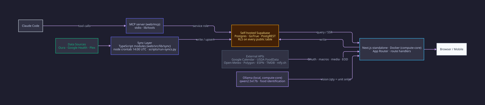

# Mr. Bridge — Personal AI Assistant

Mr. Bridge is a **single-user, self-hosted personal health companion**: one person, one deployment, one database — to use it, you run your own copy. It syncs fitness, habit, task and health data from external services into your own Supabase database, and surfaces it through a Next.js web app.

**It runs entirely on your own hardware.** Since 2026-07-13 (#476) it is off Vercel and off Supabase Cloud, running on a homelab node behind a tailnet — and it uses **no Anthropic API key**:

- **Macros come from data, not from a model.** USDA FoodData Central supplies every gram and calorie; a small local model (Ollama) only identifies the food and reads the quantity. Measured: the model was ~2x off on portion weight (a large egg at 105g; real ~50g), so it is never asked to weigh anything.
- **Conversation happens in Claude Code**, through an MCP server (`web/mcp/`) exposing all 52 tools — on your existing subscription, with no metered API.
- **Only share links are public.** The app itself is tailnet-only.

## Architecture



[View full size →](docs/architecture.png)

[Architecture decisions & RLS evolution plan →](docs/ARCHITECTURE.md)

## What you get

- **Dashboard** — Ordered for a phone check-in: greeting and live weather, today's food (the next planned meal with a one-tap "Ate this", plus macros vs targets), today's workout, habit check-in, Oura recovery, Google Calendar schedule, active tasks, then stock watchlist (sparkline + price/change, Polygon.io) and sports. **Re-entry mode:** after 3+ days with nothing logged, one calm "Welcome back. Start from today." card instead of missed-day counts. **Travel mode:** while a "Stay at …" all-day calendar event covers today, weather follows the stay's location and meal-plan prompts pause
- **Claude Code (MCP)** — the conversational surface. `web/mcp/run.sh` exposes **52 tools** (tasks, habits, fitness, meals, recipes + cooks, grocery list, calendar, backlog, profile, equipment, workouts, stocks, sports) to Claude Code or Claude Desktop. Runs on your Claude subscription — no API key, no metered chat. Laptop/desktop only: claude.ai and the mobile app can only reach *remote* MCP servers, so the web app remains the phone client.
- **Habits** — Daily toggle check-in with 30-day momentum line (rolling 7-day completion rate), per-habit current + personal-best streak rows, weekly radial completion chart, and 90-day history grid
- **Tasks** — Inline editing, priority, relative due dates, completed-tasks accordion; subtask/list hierarchy with progress indicator, expand/collapse, rapid "Add item…" entry optimised for grocery lists; completing a parent cascades to all subtasks
- **Fitness** — Body composition charts (weight + BF%), workout frequency + active calorie charts with daily/weekly granularity toggle (auto-weekly at >90d), full workout history table (start/end time, HR zones, source badge, activity filter); goal progress overlays; window selector wired through to all charts; weekly workout program (Mon–Sun plan cards with warm-up / workout / cool-down phases, expand/collapse, today badge, completed-day checkmark, Google Calendar sync, cancel action with soft-cancel + calendar delete); **inline set-by-set logging** during today's workout (weight / reps / RPE per set, kg or lb display based on your profile), end-of-workout recap with perceived-effort 1–10 and notes, recent-sessions list, and per-exercise sparklines for your top 3 lifts by volume; **expandable exercise technique panel** (tap ▾ on any exercise to show the AI-generated description + form tips); **in-app rest timer** that auto-starts after each logged set (localStorage-persisted, dismissible, on-screen completion signal only — no push, kill-switch in Settings → Fitness)
- **Journal** — Guided 5-prompt daily reflection + free-write tab; auto-save; collapsible history
- **Weekly Review** — Last 7 days at a glance: habit scores, task completion, workout summary, recovery averages, body comp delta, journal count
- **Meals** — Daily macro summary vs goals. **Food photo analyzer** and **nutrition-label scanner**, both powered by a local model + USDA FoodData Central rather than a cloud API. Describe the dish alongside the photo and your words win: a stated "6oz" is used verbatim rather than re-guessed from pixels, and naming the dish settles identification. Inline-editable review before anything is logged. 7-day meal history and macro trends.
- **Kitchen** — `/inventory` tracks what's in the fridge, freezer and pantry; logging a cook draws its ingredients out of inventory. **Grocery list:** `get_grocery_list` turns planned recipes × portions, minus what's on hand, into whole packs; `pin_grocery_product` pins a food to an Amazon Fresh product, and `receive_grocery_order` turns a delivered order into inventory rows. The `amazon-cart` skill fills the cart from the list (it never checks out).
- **Calendar** — `/calendar`: week, day and month views of your Google Calendar.
- **Library** (`/library`; old `/backlog` links redirect) — Personal media tracker for games, shows, movies, and books. Four tabbed categories with drag-to-reorder stack ranking; automatic metadata import (cover, creator, release date, description) via TMDB (movies + shows), IGDB (games), and OpenLibrary / Google Books (books); status lifecycle (backlog → active → paused → finished / dropped) with lifecycle timestamps; session log for re-watches / re-reads / replays; 0–10 rating and free-form review; shareable public read-only link per item; optional Plex watch sync marks watched movies/shows and logs sessions. MCP tools: `list_backlog`, `add_backlog_item`, `update_backlog_item`, `log_backlog_session`.
- **Notifications** — In-app notification center (`/notifications`) showing last 30 days of push notification history; type filter pills (HRV / Weather / Tasks / Birthday); unread indicator (left-border accent + bold title); red badge on the Bell nav icon; auto-marked read on page visit; 30-day TTL auto-cleanup via daily cron
- **Push notifications** — one morning summary (weather warnings, recovery with HRV-drop flag, today's workout, planned meals, due tasks), task due-date reminders, birthday reminders, coach nudges, recipe-audit findings when they change, and a weekly review nudge, via ntfy.sh (Android/iOS/macOS). See [Notifications](#notifications)
- **Status** — Settings → Status lists every scheduled job and data source with its last success, flagging late, failing and never-run ones
- **Data export** — one-click JSON or CSV zip of all your data from Settings → Data; one file per user-authored table plus a `_manifest.json` with schema version, timestamp, and row counts; optional date-range filter; encrypted OAuth tokens are deliberately excluded

---

## Prerequisites

This runs on your own hardware. You need:

| What | Notes |
|------|-------|
| **A Linux host with Docker** | The reference deployment is a homelab node (`compute-core`). ~5 GB RAM for the app + Supabase + a 7B model. |
| **Tailscale** (or equivalent) | The app and its database are **tailnet-only** — never publicly routable. Every device you use it from must be on the tailnet. |
| **A domain** | For TLS + hostnames. The reference uses `jl-infra-lab.com` via Cloudflare. |
| **Google Cloud project** | Calendar + Google Health OAuth. Free. |
| **USDA FoodData Central key** | Free, instant: <https://fdc.nal.usda.gov/api-key-signup.html>. This is where macros come from. |
| **Ollama** | Local model for food identification. CPU is fine. |
| Google Health / Oura *(optional)* | Google Health replaced Fitbit + Google Fit in [#607](https://github.com/Theioz/mr-bridge-assistant/issues/607). |

**No Anthropic API key. No Vercel account. No Supabase Cloud account.** Conversation runs through Claude Code on your existing subscription (see the MCP section).

## Setup guide

### Step 1 — Clone the repo

```bash
git clone https://github.com/Theioz/mr-bridge-assistant.git
cd mr-bridge-assistant
```

### Step 2 — Stand up Supabase (self-hosted)

The Supabase stack lives in the [jl-homelab](https://github.com/Theioz/jl-homelab) repo at `docker/supabase/` — three containers (Postgres 17.6 + GoTrue + PostgREST) plus a tiny local Caddy gateway. See its README for the full bring-up; the short version:

```bash
cd docker/supabase
./gen-keys.sh                # mint JWT_SECRET + anon + service_role keys
docker compose up -d db      # 1. Postgres
docker compose up -d auth    # 2. GoTrue creates the auth schema
./restore.sh                 # 3. restore a dump, if migrating
docker compose up -d rest    # 4. PostgREST
```

Then apply this repo's migrations (`supabase/migrations/`) with `psql` or the Supabase CLI.

**The keys are not interchangeable with Cloud's.** Supabase Cloud issues `sb_publishable_`/`sb_secret_` keys, which are a Cloud-only auth system; self-hosted GoTrue and PostgREST verify **legacy JWTs**. `gen-keys.sh` mints the right kind.

### Step 3 — Get a USDA FoodData Central key

<https://fdc.nal.usda.gov/api-key-signup.html> — free, arrives by email immediately. Set `FDC_API_KEY`.

This is what replaced Claude for nutrition. The macros are read from measured data rather than recalled by a model, which is *more* accurate, not less.


### Step 4 — Set up Google Cloud OAuth

This step enables Calendar and optionally Google Health. It's the most involved step but only needs to be done once.

**Create a Google Cloud project and enable APIs:**

1. Go to [console.cloud.google.com](https://console.cloud.google.com) → click the project dropdown → **New Project**. Name it anything (e.g. `mr-bridge`).
2. In the left sidebar: **APIs & Services → Library**. Search for and enable each of these:
   - **Google Calendar API**
   - **Google Health API** *(only if you sync workouts / body composition)*

**Configure the OAuth consent screen:**

3. Go to **APIs & Services → OAuth consent screen** → **External** → **Create**.
4. Fill in:
   - App name: anything (e.g. `Mr. Bridge`)
   - User support email: your email
   - Developer contact email: your email
5. Click through Scopes (no changes needed) → **Test users** → add your own Google email address. This is required while the app is in "Testing" status — without it, OAuth will be blocked.
6. Save and continue.

**Create OAuth credentials:**

7. Go to **APIs & Services → Credentials → Create Credentials → OAuth 2.0 Client ID**.
8. Application type: **Web application**. Name it anything. Under **Authorized redirect URIs** add `https://<your-host>/api/auth/google/callback` (and `http://localhost:3000/api/auth/google/callback` for local dev), and set the same value as `GOOGLE_OAUTH_REDIRECT_URI`. The app redirects back to a hostname, which a Desktop-app client cannot register.
9. Copy the client ID and secret into `GOOGLE_CLIENT_ID` and `GOOGLE_CLIENT_SECRET`.

**Connect Google in the web app:**

10. After deploying (Step 8), go to **Settings → Integrations → Connect Google**. This opens the Google consent screen and stores your refresh token encrypted in Supabase. No env token is needed.

### Step 5 — Set up fitness integrations *(optional)*

Skip any integrations you don't use. The app works with none, one, or all of them.

**Oura Ring** *(OAuth2 — Oura deprecated Personal Access Tokens, #732)*:
1. Register an application in the Oura developer console ([cloud.ouraring.com/oauth/applications](https://cloud.ouraring.com/oauth/applications)) with redirect URI `https://<your-host>/api/auth/oura/callback`.
2. Set `OURA_CLIENT_ID`, `OURA_CLIENT_SECRET` and `OURA_OAUTH_REDIRECT_URI` in `.env`. Scopes default to `daily spo2`; `OURA_SCOPES` overrides them without a rebuild.
3. In your running app, go to **Settings → Integrations → Connect Oura**. The refresh token is stored encrypted in `user_integrations`; Oura rotates it on every refresh and the sync persists the new one.

**Google Health** *(replaces Fitbit and Google Fit — see [#607](https://github.com/Theioz/mr-bridge-assistant/issues/607))*:
1. Enable the [Google Health API](https://console.cloud.google.com/apis/library/health.googleapis.com) on the **same** Google Cloud project from Step 4.
2. On the **Data Access** page, add both read scopes:
   - `.../auth/googlehealth.activity_and_fitness.readonly`
   - `.../auth/googlehealth.health_metrics_and_measurements.readonly`

   These are **restricted** scopes, so the console will demand verification. Verification is only needed to exceed 100 users; Google documents an explicit exception for apps used only by their developer. Proceed past the warning.
3. Set the OAuth **publishing status to "In production"**. Not optional — an app in *Testing* gets refresh tokens that **expire after 7 days**, which breaks the unattended sync.
4. Add `https://<your-host>/api/auth/google-health/callback` as an authorized redirect URI on the **existing** OAuth client and set `GOOGLE_HEALTH_OAUTH_REDIRECT_URI` in `.env`. There is no separate client ID or secret — it reuses `GOOGLE_CLIENT_ID` / `GOOGLE_CLIENT_SECRET`.
5. In your running app, go to **Settings → Integrations → Connect Google Health**. Click through the "Google hasn't verified this app" screen. The refresh token is stored encrypted in `user_integrations`.

   It is consented *separately* from the `google` integration on purpose. The original reason was Gmail — Google revokes refresh tokens carrying Gmail scopes on password change — and #693 removed that scope, but the split still earns its keep: this token feeds an unattended cron, and an interactive Calendar re-consent should not be able to invalidate it.

### Step 6 — Set up push notifications via ntfy.sh *(optional)*

1. Install the **ntfy** app on your phone ([Android](https://play.google.com/store/apps/details?id=io.heckel.ntfy) / [iOS](https://apps.apple.com/app/ntfy/id1625396347)).
2. Choose a unique topic name — something like `mr-bridge-yourname-1234`. No account needed.
3. Subscribe to your topic in the app.
4. Set `NTFY_TOPIC` to that same string in your `.env` file.

For platform-specific setup (macOS banners, Android background delivery, Windows) see [docs/notifications-setup.md](docs/notifications-setup.md).

Also set `APP_URL` in `.env` to your app's hostname (e.g. `https://mr-bridge.jl-infra-lab.com`), and `SHARE_BASE_URL` to the public share host.

#### Notifications

All notifications are ntfy pushes that also land in the in-app Notifications page. One path sends
them: `scripts/_push.py` (`scripts/notify.sh` wraps it). The schedule lives in the host crontab
(for this deployment, jl-homelab `system/cron/compute-core-crontab`); host-side entries override
`SUPABASE_URL` to `http://localhost:8000`, because `.env`'s `SUPABASE_URL` is
`http://host.docker.internal:8000`, an address that only resolves inside a container.

| Script | Schedule (UTC) | What it sends |
|---|---|---|
| `check_morning_summary.py` | 14:30 daily | Weather (with storm, heat, freeze and wind flags), last night's recovery (with HRV-drop flag), today's workout, planned meals, due tasks |
| `check_task_due_alerts.py` | 00:00 + 16:00 daily | Due-today and overdue tasks, per-task 24 h dedup |
| `check_journal_reminder.py` | 02:00 daily (7 PM Pacific) | A journal nudge, only if nothing was journaled today |
| `check_birthday_notif.py` | 15:00 daily | Birthdays on your Google Calendar (read over plain HTTPS by `scripts/_google.py`) |
| `check_series_expiring.py` | Mon 16:00 | Recurring task series about to run out |
| `/api/cron/audit-recipes` | Mon 15:00 | Recipe-library drift findings, only when they changed since the last run |
| `check_stale_signals.py` | every 6 h | Nothing directly: exits 10 with a reason when a job or data source is stale, and Uptime Kuma pages it |
| `coach_check.py` | Sun/Tue/Thu 03:00, Mon 01:00 | Missed-session and weekly-planning nudges |

Every scheduled job writes a heartbeat to `sync_log`. **Settings → Status** shows each one's last
success. Alerting is Uptime Kuma's: every cron runs under the homelab `heartbeat` wrapper, and
`check_stale_signals.py` adds what Kuma can't see (a data source going stale inside a green
`/api/cron/sync` run) by failing its own heartbeat with the reason. The job list is
`web/src/lib/status/jobs.json`: add a job there when you schedule it, or it is invisible.

**Delivery log:** every send appends a line to `~/.mr-bridge/notify.log` (title, type, HTTP
status; never the ntfy topic):

```bash
tail -f ~/.mr-bridge/notify.log
```

### Step 7 — Configure environment variables

```bash
cp .env.example .env                      # Python scripts, the MCP server, the app container
cp web/.env.local.example web/.env.local  # local `npm run dev` only
```

`.env.example` documents every variable, including which ones are load-bearing. The ones worth reading twice:

| Variable | Why it matters |
|---|---|
| `ENCRYPTION_KEY` | The pgcrypto key for `user_integrations.refresh_token_encrypted` — your Google/Google Health/Oura **refresh tokens**. Lose it and every integration must be re-authorised by hand. **Prove it decrypts a real row before trusting any restore**: the wrong key restores a healthy-looking database in which every integration silently fails. |
| `SUPABASE_URL` vs `SUPABASE_INTERNAL_URL` | The browser and the server reach Supabase on **different** URLs. The app container has no route to the tailnet vhost, so it uses a node-local gateway. Collapsing these into one breaks every server-side call with `TypeError: fetch failed`. |
| `NTFY_TOPIC` | Mind the spelling. Production once had `NFTY_TOPIC`, and push notifications silently 503'd for months. |
| `SHARE_BASE_URL` | Share links go to people *outside* the tailnet, so they must resolve on the public host. Using `APP_URL` hands recipients an unreachable link. |

`NEXT_PUBLIC_*` values are inlined into the **client bundle at build time**, not read at runtime — so they must be right when the image is built, or the browser silently talks to `undefined`.

### Step 8 — Deploy

The app is a plain Docker image (`web/Dockerfile`, Next.js standalone output). The homelab stacks live in [jl-homelab](https://github.com/Theioz/jl-homelab): `docker/mr-bridge/`, `docker/supabase/`, `docker/ollama/`.

```bash
# in jl-homelab docker/mr-bridge/ — the compose file builds from your clone of this repo
docker compose build && docker compose up -d
```

The scheduled Python scripts run on the host from a virtualenv in the repo clone:

```bash
python3 -m venv .venv && .venv/bin/pip install -r scripts/requirements.txt
```

**Ingress** — three hostnames, three exposure levels:

| Hostname | Reach | What |
|---|---|---|
| `mr-bridge.<domain>` | **tailnet only** | The full app. Health data is never publicly routable. |
| `supabase.<domain>` | **tailnet only** | The database gateway. It *must* be a real hostname — the browser talks to Supabase directly, so it cannot hide on the Docker network. |
| `share.<domain>` | **public** | Only token-gated `/share/*`, behind a default-deny path allowlist. The dashboard, meals, journal, fitness, settings and the entire API return **404** from the internet. |

**Cron** — `web/vercel.json` is gone. `/api/cron/sync` (Oura, Google Health, Plex, stocks, sports) and `/api/cron/audit-recipes` run from the node's crontab, authenticated with `CRON_SECRET` exactly as before. The weekly planner moved to a Claude Code command (see below).

### Step 8b — Wire up the MCP server (this is the chat)

There is no in-app chat. `web/mcp/server.ts` exposes all 52 tools to Claude Code:

```bash
# secrets live OUTSIDE the repo — a service-role key in a tree you `git add -A`
# is one typo from publication
bw get notes mr-bridge-env > ~/.mrb-secrets/env && chmod 600 ~/.mrb-secrets/env
```

`.mcp.json` already registers it. Open Claude Code in the repo and the tools are there.

**Laptop/desktop only.** claude.ai and the Claude mobile app can only reach *remote* MCP servers over HTTPS; a stdio server on your machine is invisible to them. The web app remains the phone client — which is the intended split: **phone for logging, laptop for thinking**.


### Step 9 — Connect Google Calendar + Gmail in Claude Code

The CLI assistant reaches Calendar and Gmail through claude.ai's own hosted connectors. These are
enabled on your claude.ai account, **not** in this repo — `.mcp.json` registers only `mr-bridge`
and `playwright`.

1. Open Claude Code in the project directory:
```bash
claude
```
2. Run `/mcp` in the Claude Code session and follow the prompt to authenticate with your Google account.

You only need to do this once. Claude Code will remember the auth for future sessions.

### Step 10 — Seed your profile

Mr. Bridge reads a flat key-value `profile` table in Supabase. Fill in your details one of two ways:

- **Web app** → open the web interface → **Settings** → fill in Name, Home Location, Target Weight, nutrition goals, and fitness goals, then save each field. The Appearance section lets you pick System / Light / Dark (persisted to `profile.theme_preference`; header toggle and Settings radio stay in sync). The **Equipment** section lets you log your gym equipment (dumbbell pairs, barbells, resistance bands, etc.) so Bridge proposes exercises within your actual inventory.
- **Claude Code** → the `update_profile` MCP tool: *"Set my weight goal to 160 lbs"* or *"My name is Jason"*.

### Step 11 — First session

```bash
cd mr-bridge-assistant
claude
```

A `SessionStart` hook (`.claude/hooks/scripts/hooks.py`) starts the briefing automatically: Mr. Bridge will sync fitness data, query Supabase, fetch your calendar and important mail through the claude.ai connectors from Step 9 (the web app itself no longer reads Gmail, #693), and deliver the session briefing. On your very first run it will ask for your name if it isn't in the profile table yet.

### Step 12 — Weekly plan *(optional)*

Next week's workout + meal-prep plan is generated by the **`/weekly-plan`** Claude Code command,
on your subscription — there is no scheduled cloud agent and no Anthropic API call. Claude is the
planner; the structural rules (muscle coverage, recovery spacing, same-day redundancy, superset
metadata) live in `scripts/weekly_plan.py` and are enforced, not interpreted:

```bash
INTERNAL_APP_URL=http://localhost:3000 python3 scripts/weekly_plan.py context  --week-start <monday>
python3 scripts/weekly_plan.py validate /tmp/plan.json
INTERNAL_APP_URL=http://localhost:3000 python3 scripts/weekly_plan.py submit   /tmp/plan.json --week-start <monday>
```

Run it on compute-core: the script calls the app's AI-free `/api/internal/plan` endpoints, and the
tailnet `APP_URL` is not reachable from that node. `submit` writes `workout_plans` rows and the
meal-prep task. See `.claude/commands/weekly-plan.md` for the full procedure.

---

## Slash commands

| Command | Description |
|---------|-------------|
| `/log-habit [habits...]` | Log habit completions for today |
| `/session-briefing` | Re-run the full session briefing on demand |
| `/weekly-review` | Run the weekly habit + accountability summary |
| `/weekly-plan` | Generate, validate and write next week's workout + meal-prep plan |

Skills in `.claude/skills/`: `plan-week` (training + meals for the coming week, with grocery list and prep tasks), `amazon-cart` (fill the Amazon Fresh cart from the grocery list, never checks out; drives the owner's own signed-in Chrome), `log-habit`, `send-notification`, and `ui-ux-pro-max` (design reference).

---

## Web interface — local development

```bash
cd web
npm install   # also installs the pre-commit hook via the prepare script
npm run dev   # http://localhost:3000
```

Requires `web/.env.local` to be filled in (see Step 7). The app runs entirely against your Supabase instance — the same data you see in production.

---

## Running smoke tests

**Parked (#476).** The Playwright suite cannot run on a GitHub-hosted runner any more,
and no edit to the specs fixes that: the app and Supabase are **tailnet-only**, so a cloud
runner has no route to either and every spec fails at login. `.github/workflows/smoke.yml`
runs on `workflow_dispatch` (suite `a11y` or `release`), plus a weekly a11y run that is a
no-op unless the repo variable `SMOKE_SCHEDULE_ENABLED` is `true` — so it never fails by
accident.

Re-enabling means either a self-hosted runner on the tailnet, or standing up a throwaway
Supabase + app inside the job.

The chat specs are **gone** (`chat.spec.ts`, `chat-multi-turn-smoke.spec.ts`,
`tool-status-feedback.spec.ts`) — there is no chat to test. The auth, export and a11y
specs are still valuable and were kept.

```bash
cd web && npm run smoke:a11y    # a11y sweep (still useful locally)
```


## File structure

> The tool count, the migration summary and every path below are **checked in CI**
> (`node scripts/check-docs.mjs`, `--fix` to rewrite the derivable numbers). This README claimed
> four different tool counts before #700, and listed a route deleted four months earlier — the
> check exists so the next drift is caught rather than re-filed. It is a guided tour, not an
> inventory: not every file appears, but every file that appears must exist.

```
mr-bridge-assistant/
├── CLAUDE.md                              # Session bootstrap (loads rules via @path)
├── CHANGELOG.md
├── README.md
├── .env.example                           # Root env var template (Python scripts, MCP server, app container)
├── .gitignore
├── .mcp.json                              # MCP servers for this repo: mr-bridge + playwright
│
├── supabase/                              # Database schema + migrations
│   ├── config.toml
│   └── migrations/                        # 82 files, newest 20261019120000_program_tracking.sql
│
├── web/                                   # Next.js web app (self-hosted Docker; web/Dockerfile)
│   ├── .env.local.example                 # Web app env var template
│   ├── src/
│   │   ├── app/
│   │   │   ├── (protected)/               # Auth-gated pages
│   │   │   │   ├── layout.tsx             # Protected layout with sidebar
│   │   │   │   ├── page.tsx               # Redirect → /dashboard
│   │   │   │   ├── dashboard/page.tsx     # Daily dashboard — food, workout, habits, recovery, schedule; re-entry + travel modes
│   │   │   │   ├── calendar/page.tsx      # Google Calendar — week, day, month views
│   │   │   │   ├── inventory/page.tsx     # Fridge, freezer, pantry
│   │   │   │   ├── library/page.tsx       # Media library — games, shows, movies, books
│   │   │   │   ├── notifications/page.tsx # Last 30 days of push history
│   │   │   │   ├── onboarding/page.tsx    # First-run wizard (8 steps) — auth callback redirects here until onboarding is done; sets onboarding_completed in profile on finish
│   │   │   │   ├── tasks/page.tsx         # Task management
│   │   │   │   ├── habits/page.tsx        # Habit tracking — add/archive + 7/30/90d history
│   │   │   │   ├── fitness/page.tsx       # Body composition + workouts
│   │   │   │   ├── weekly/page.tsx        # Weekly review — habits, tasks, workouts, recovery, body comp, journal
│   │   │   │   ├── meals/page.tsx         # Meal log + FoodPhotoAnalyzer (photo → local model + USDA → macros → log)
│   │   │   │   ├── meals/FoodPhotoAnalyzer.tsx  # Client component: food photo or label scan, serving multiplier, daily macro context
│   │   │   │   ├── journal/page.tsx       # Daily journal — guided 5-prompt flow + free write
│   │   │   │   ├── backlog/page.tsx       # Redirect → /library (old bookmarks)
│   │   │   │   ├── backlog/[id]/page.tsx  # Redirect → /library/[id]
│   │   │   │   └── settings/page.tsx      # Profile key-values + nutrition/fitness goal calculator
│   │   │   ├── api/
│   │   │   │   ├── sync/
│   │   │   │   │   ├── oura/route.ts      # POST — sync last 3d Oura data → recovery_metrics
│   │   │   │   │   ├── google-health/route.ts  # POST — sync last 7d body + workouts
│   │   │   │   ├── backlog/
│   │   │   │   │   ├── search/route.ts          # GET — proxy TMDB/IGDB/OpenLibrary metadata search
│   │   │   │   │   ├── import/route.ts          # POST — bulk commit a CSV import (one dup select, one insert)
│   │   │   │   │   ├── import/resolve/route.ts  # POST — resolve a 25-row chunk against TMDB; writes nothing
│   │   │   │   │   ├── route.ts                 # GET list, POST create
│   │   │   │   │   └── [id]/
│   │   │   │   │       ├── route.ts             # GET detail, PATCH update, DELETE
│   │   │   │   │       ├── sessions/route.ts    # GET + POST sessions
│   │   │   │   │       ├── share/route.ts       # POST generate token, DELETE revoke
│   │   │   │   │       └── priority/route.ts    # PATCH priority (drag-to-reorder)
│   │   │   │   ├── cron/
│   │   │   │   │   ├── sync/route.ts      # GET — node crontab hits this daily 14:00 UTC; CRON_SECRET auth
│   │   │   │   │   └── audit-recipes/route.ts # GET — weekly recipe audit; pushes only when findings change
│   │   │   │   ├── weather/route.ts       # Open-Meteo forecast (no API key)
│   │   │   │   ├── meals/
│   │   │   │   │   ├── analyze-photo/route.ts   # POST — local model: identify food for USDA macros (mode=food) or read a nutrition label (mode=label)
│   │   │   │   │   ├── estimate-macros/route.ts # POST — re-estimate from edited ingredients (local model + USDA)
│   │   │   │   │   └── log/route.ts             # POST — insert meal_log row; PATCH — inline edit
│   │   │   │   ├── stocks/
│   │   │   │   │   └── validate/route.ts        # GET — proxy Polygon ticker validation (keeps API key server-side)
│   │   │   │   ├── sports/
│   │   │   │   │   └── search/route.ts          # GET — search sports events by league/team
│   │   │   │   ├── notifications/
│   │   │   │   │   └── unread-count/route.ts    # GET — count unread notifications for badge
│   │   │   │   ├── strength-sessions/
│   │   │   │   │   └── route.ts                 # GET/POST — strength session log (sets, reps, weight per exercise)
│   │   │   │   ├── workout-plans/
│   │   │   │   │   └── backfill-descriptions/route.ts # POST — local-model exercise descriptions for existing plan entries
│   │   │   │   ├── exercise-prs/
│   │   │   │   │   └── backfill/route.ts        # POST — compute personal records from historical strength_session_sets
│   │   │   │   ├── export/
│   │   │   │   │   └── route.ts           # POST — generate per-user JSON/CSV zip of all user-authored tables
│   │   │   │   ├── auth/
│   │   │   │   │   ├── google/start/route.ts    # GET — initiate Google OAuth flow
│   │   │   │   │   ├── google/callback/route.ts # GET — handle Google OAuth callback; store encrypted refresh token
│   │   │   │   │   ├── google-health/start/route.ts    # GET — initiate Google Health OAuth (health scopes only)
│   │   │   │   │   ├── google-health/callback/route.ts # GET — handle callback; store encrypted refresh token
│   │   │   │   │   ├── oura/start/route.ts             # GET — initiate Oura OAuth2 (#732)
│   │   │   │   │   └── oura/callback/route.ts          # GET — handle callback; store encrypted refresh token
│   │   │   │   └── google/
│   │   │   │       ├── calendar/route.ts              # GET — today's Google Calendar events (dashboard widget)
│   │   │   │       ├── calendar/events/route.ts       # GET/POST — list or create calendar events
│   │   │   │       ├── calendar/events/[eventId]/route.ts # PATCH/DELETE — update or delete a specific event
│   │   │   │       ├── calendar/range/route.ts        # GET — events over a date range (weekly workout plan sync)
│   │   │   │       ├── calendar/upcoming-birthday/route.ts # GET — next birthday event from Calendar
│   │   │   ├── share/
│   │   │   │   └── backlog/[token]/page.tsx # Public read-only backlog item view (no auth; token = auth)
│   │   │   ├── error.tsx                   # Top-level error boundary (friendly + retry)
│   │   │   ├── (protected)/error.tsx       # Protected-route error boundary (retry + dashboard fallback)
│   │   │   └── login/
│   │   │       ├── layout.tsx              # Server shell so client login page can export metadata
│   │   │       └── page.tsx
│   │   ├── components/
│   │   │   ├── nav.tsx                    # Left sidebar (desktop); bottom tab bar + More sheet (mobile)
│   │   │   ├── ui/
│   │   │   │   ├── logo.tsx               # MB monogram SVG
│   │   │   │   └── sheet.tsx              # Radix-Dialog-backed bottom sheet (focus trap, Escape, role=dialog)
│   │   │   ├── tasks/                     # Task CRUD components
│   │   │   ├── habits/                    # Habit toggle, add/archive UI, momentum line, streak rows, radial
│   │   │   ├── fitness/                   # Body comp, workout freq, active cal, goal charts (Recharts)
│   │   │   │   └── weekly-workout-plan.tsx  # Mon–Sun workout plan cards with phases + Calendar sync
│   │   │   ├── journal/                   # Guided journal flow + history list
│   │   │   ├── settings/
│   │   │   │   ├── watchlist-settings.tsx # Stock watchlist editor (add/remove tickers, server-proxy validation)
│   │   │   │   ├── data-settings.tsx      # Data export UI — format + range picker, POST /api/export, download zip
│   │   │   │   └── status-settings.tsx    # Status tab — every scheduled job's last success; late jobs flagged (#761)
│   │   │   └── dashboard/
│   │   │       ├── empty-state.tsx        # Shared icon+text empty/error state for dashboard widgets
│   │   │       ├── schedule-today.tsx     # Google Calendar card
│   │   │       ├── tasks-summary.tsx      # Active tasks card
│   │   │       └── watchlist-widget.tsx   # Stock ticker rows: sparkline + price/change; refresh button
│   │   └── lib/
│   │       ├── timezone.ts                # Timezone-aware date helpers (USER_TIMEZONE)
│   │       ├── reentry.ts                 # Re-entry mode: days since anything was hand-logged
│   │       ├── travel/stay.ts             # Travel mode: the "Stay at …" event covering today
│   │       ├── status/jobs.json           # Scheduled-job registry — Settings → Status + check_stale_signals.py
│   │       ├── supabase/                  # Client, server, service clients
│   │       ├── types.ts                   # TypeScript interfaces for all DB tables
│   │       ├── backlog/
│   │       │   ├── tmdb.ts                # TMDB movie + show search, and find-by-IMDb-id for imports (TMDB_API_KEY)
│   │       │   ├── igdb.ts                # IGDB game search (Twitch OAuth client_credentials)
│   │       │   └── openlibrary.ts         # OpenLibrary book search + Google Books fallback
│   │       ├── export/
│   │       │   ├── tables.ts              # Declarative registry of tables included in data export (#67)
│   │       │   └── csv.ts                 # Deterministic CSV serializer (ordered columns, CRLF)
│   │       ├── import/
│   │       │   ├── csv.ts                 # RFC 4180 CSV reader — the counterpart to export/csv.ts
│   │       │   └── media-csv.ts           # Column-map library import; IMDb ships, other sources are config (#690)
│   │       ├── nutrition/                 # Macros, the kitchen, and the audits that keep them honest
│   │       │   ├── fdc.ts                 # USDA FoodData Central client — every gram and calorie comes from here
│   │       │   ├── recipe-macros.ts       # The USDA resolver; the ONLY place macros_computed_at is stamped
│   │       │   ├── recipe-portions.ts     # The ingredient list is the BATCH, recipes.calories is ONE SERVING
│   │       │   ├── recipe-structured.ts   # Ingredient parsing + the invariants the DB trigger mirrors
│   │       │   ├── recipe-audit.ts        # Library drift detector — shared by the CLI and the weekly cron
│   │       │   ├── cooks.ts               # createCook / eatFromCook / eatFromRecipe — prepared leftovers
│   │       │   ├── inventory.ts           # Raw ingredients on hand: fridge, freezer, pantry
│   │       │   ├── inventory-draw.ts      # Cook time: moves mass out of inventory_items into cooks (#649)
│   │       │   ├── estimate.ts            # Free-text meal → USDA-resolved macros
│   │       │   └── targets.ts             # Daily macro targets from the profile
│   │       └── sync/
│   │           ├── oura.ts                # syncOura() — Oura endpoints → recovery_metrics
│   │           ├── google-health.ts       # syncGoogleHealth() — body comp + workouts + HR zones
│   │           ├── plex.ts                # syncPlex() — Plex watch history → library status, sessions, rate prompts
│   │           ├── stocks.ts              # syncStocks() — Polygon.io EOD + sparkline → stocks_cache
│   │           └── log.ts                 # logSync() + lastSyncAgeSecs() helpers
│   └── package.json
│
├── .claude/
│   ├── rules/
│   ├── agents/
│   │   ├── weekly-review.md               # Sunday 8pm weekly summary agent
│   ├── commands/
│   │   ├── log-habit.md                   # /log-habit slash command
│   │   ├── session-briefing.md            # /session-briefing slash command
│   │   ├── weekly-review.md               # /weekly-review slash command
│   │   └── weekly-plan.md                 # /weekly-plan slash command (Claude is the planner)
│   ├── skills/
│   │   ├── plan-week/SKILL.md             # Week of training + meals, grocery list, prep tasks
│   │   ├── amazon-cart/SKILL.md           # Fill the Amazon Fresh cart from the grocery list (never checks out)
│   │   ├── send-notification/SKILL.md     # ntfy push + in-app history row, via scripts/notify.sh
│   │   └── log-habit/SKILL.md             # Habit logging skill (writes to Supabase)
│   ├── hooks/
│   │   └── scripts/hooks.py               # SessionStart (auto-briefing), PostToolUse and Stop hooks (Python 3)
│   ├── settings.json
│   └── references/
│       └── best-practice/                 # Submodule: shanraisshan/claude-code-best-practice
│
├── .github/
│   └── workflows/
│       ├── weekly-review-nudge.yml        # Sunday 8pm ntfy.sh push (runs in cloud)
│       ├── lint.yml                       # Token guards, client/server boundary, eslint + prettier, typecheck, depcheck, docs check
│       ├── build.yml                      # `next build` on PRs touching web/**
│       ├── smoke.yml                      # Playwright a11y + perf smokes (manual; weekly when enabled)
│       └── python-tests.yml               # "Unit tests": python (tests/) + node (web/src/__tests__)
│
├── docs/
│   ├── notifications-setup.md             # Android, macOS, Windows ntfy setup guide
│   ├── fitness-tracker-setup.md           # Google Health + Oura setup
│   ├── google-oauth-setup.md              # OAuth token setup + refresh guide
│   └── gmail-multi-account.md             # Auto-forwarding + Calendar sharing setup
│
├── scripts/
│   ├── check-docs.mjs                     # Asserts this README still describes the repo (#700) — CI + `--fix`
│   ├── lint-tokens.sh                     # Design-token guards (no inline hover, no raw hex)
│   ├── _supabase.py                       # Shared Supabase client; loads the root .env
│   ├── _push.py                           # The one notification path: ntfy push + in-app history row
│   ├── _google.py                         # Google Calendar over plain HTTPS (no googleapiclient)
│   ├── _joblog.py                         # Cron jobs' sync_log heartbeat (feeds Settings → Status)
│   ├── requirements.txt                   # Python dependencies (python-dotenv, supabase)
│   ├── fetch_briefing_data.py             # Queries Supabase → outputs session briefing data (incl. weather)
│   ├── fetch_weather.py                   # Open-Meteo weather helper; location from profile
│   ├── log_habit.py                       # Logs habit completions to Supabase
│   ├── run-syncs.py                       # Triggers /api/cron/sync, then the alert scripts
│   ├── check_birthday_notif.py            # Birthday push alerts from Google Calendar
│   ├── check_task_due_alerts.py           # Task due-date push alerts (grouped, per-task 24h dedup)
│   ├── check_journal_reminder.py          # 7 PM Pacific journal nudge, only if nothing journaled today
│   ├── check_morning_summary.py           # Morning push: weather, recovery, workout, meals, tasks
│   ├── check_series_expiring.py           # Weekly: recurring task series about to run out
│   ├── check_stale_signals.py             # Fails its Uptime Kuma heartbeat when a job or data source goes stale
│   ├── coach_check.py                     # Missed-session and weekly-planning nudges
│   ├── spawn_task_occurrences.py          # Daily: creates the next occurrences of recurring tasks
│   ├── purge_completed_tasks.py           # Nightly: deletes completed tasks older than 90 days (#684)
│   ├── notify.sh                          # Shell wrapper over _push.py
│   ├── weekly_plan.py                     # Weekly planner: context / validate / submit (structural rules live here)
│   └── update-references.sh              # Pull latest best practices submodule
│
└── tests/                                 # Python unit tests (stdlib unittest, no deps)
    └── test_weekly_plan_supersets.py      # Superset-metadata validator
                                           # TS unit tests live in web/src/__tests__/ and
                                           # run in the same workflow (node --test, no deps)
```

> All live data (habits, tasks, fitness, recovery, recipes, meals) is stored in **Supabase** — not local files.

## Self-Hosting

This section used to be a fork-and-deploy-to-Vercel guide. It isn't any more — the
project genuinely self-hosts now (#476), and that changes what you need to know.

### What you are actually running

| Piece | Where |
|---|---|
| Next.js app | Docker (`web/Dockerfile`, standalone output). Built on the node from a git checkout. |
| Supabase | **3 containers** — Postgres 17.6 + GoTrue + PostgREST, plus a small local Caddy gateway. Not Kong, not Realtime, not Storage, not edge-runtime, not analytics, not the pooler. None of them are used. |
| Local model | Ollama (`qwen2.5vl:7b`), CPU, loopback-only. |
| Nutrition data | USDA FoodData Central. |
| Chat | Claude Code + MCP (`web/mcp/`), on your subscription. |

Stacks live in [jl-homelab](https://github.com/Theioz/jl-homelab) under `docker/{mr-bridge,supabase,ollama}/`.

### The four traps

Vercel + Supabase Cloud let the browser and the server share **one URL**. Self-hosting
splits them, and each layer breaks separately — all four are runtime-only failures that
no code review catches:

1. **Server-side fetch.** The app used `NEXT_PUBLIC_SUPABASE_URL` server-side. Once the
   server is inside a tailnet and the URL points at a host it cannot route to, every
   service-role call, cron run and RSC page dies with `TypeError: fetch failed`.
   Fix: a separate `SUPABASE_INTERNAL_URL`.
2. **`host.docker.internal` is not the host's loopback.** It maps to the bridge gateway
   (172.17.0.1), so it cannot reach a container published on `127.0.0.1`. Use a shared
   Docker network.
3. **CORS.** GoTrue answers `OPTIONS` with a bare 204 and **no** `Access-Control-Allow-Origin`
   — upstream, *Kong* adds it. Drop Kong and login fails with a useless "Failed to fetch".
   PostgREST handles its own preflight, which is why only login breaks.
4. **The auth cookie name.** `@supabase/ssr` derives it from the Supabase URL's *hostname*.
   With two different URLs, the browser writes one cookie and the server looks for another.
   Login **succeeds**, then middleware finds no session and bounces you to `/login` forever,
   with no error shown. Pin `cookieOptions.name`.

### Keys do not carry over

Supabase Cloud issues `sb_publishable_` / `sb_secret_` keys — a Cloud-only auth system.
Self-hosted GoTrue and PostgREST verify **legacy JWTs**. Mint them with
`docker/supabase/gen-keys.sh`. (The upside: a Cloud project keeps working on its own keys
while you migrate, so it can serve as a rollback until you retire it.)

### Backups are now your problem

Supabase Cloud's managed PITR does **not** come with you, and this repo's own
Settings → Data export is **not a backup** — it deliberately excludes
`user_integrations` (the encrypted OAuth tokens), so it cannot restore an account.
Run a nightly `pg_dump` of both the `public` **and** `auth` schemas and put it somewhere
else. `auth` matters because every table foreign-keys to `auth.users(id)` and
`OWNER_USER_ID` is a literal UUID in your env — if those IDs change, everything breaks.

### Required environment

See `.env.example` — it documents every variable and flags the load-bearing ones.
There is **no** `ANTHROPIC_API_KEY`, **no** `GROQ_API_KEY`, and **no** Vercel anything.


## Changelog

See [CHANGELOG.md](CHANGELOG.md) for full version history.

---

<sub>Originally built by [Jason Leung](https://github.com/Theioz).</sub>
