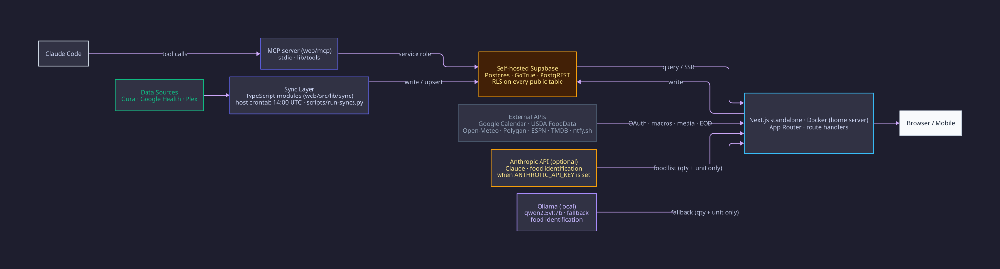

# Mr. Bridge

Mr. Bridge is a **single-user personal health companion**: one owner, one deployment, one database. It pulls fitness, recovery, calendar and media data into a self-hosted Postgres database and shows it in a Next.js web app. Conversation happens in Claude Code, through an MCP server in this repo.

This repository is the owner's own deployment, published as source. It is **not a product with an install path**: the Docker stacks, reverse proxy, DNS and schedule that run it live in a separate private repository. The code and the docs here are accurate for that deployment; adapting them to another one is your own work.



[Full-size diagram](docs/architecture.png)

## How it runs

The app is a Next.js standalone build in one Docker container on a home server, behind a reverse proxy. It is reachable only from a private network (a tailnet); one separate public hostname serves token-gated share links and nothing else. The database is self-hosted Supabase trimmed to three services, Postgres, GoTrue (auth) and PostgREST, with no Kong, Realtime or Storage. Scheduled work (data syncs, push notifications, recurring tasks) runs from the host's crontab, not from the app. Nutrition numbers come from USDA FoodData Central; a model only identifies the food and reads the quantity, and that model is Claude through the Anthropic API when `ANTHROPIC_API_KEY` is set, with a local Ollama model as the fallback. Details: [docs/ARCHITECTURE.md](docs/ARCHITECTURE.md) and [docs/OPERATIONS.md](docs/OPERATIONS.md).

## What it does

| Area | Route | What is there |
|---|---|---|
| Dashboard | `/dashboard` | A phone check-in: weather, today's food with a one-tap "Ate this" on the next planned meal, today's workout, habits, Oura recovery, calendar, active tasks, stock watchlist, sports. Re-entry mode after 3+ days with nothing logged; travel mode while a "Stay at ..." calendar event covers today |
| Habits | `/habits` | Daily check-in, streaks, a rolling 7-day completion line, 90-day history |
| Tasks | `/tasks` | Lists, subtasks, priorities and due dates; recurring series; one task can block another; completed tasks are kept 90 days, then deleted |
| Fitness | `/fitness` | Body-composition and workout charts, the weekly workout plan, set-by-set strength logging with a rest timer, personal records, exercise technique notes |
| Weekly | `/weekly` | The last 7 days: habits, tasks, workouts, recovery, body composition, journal; a program Scorecard (weight trend against the target rate, steps, waist, alcohol and cheat-meal budgets) |
| Meals | `/meals` | Daily macros against targets; food-photo analyzer and nutrition-label scanner; recipe library with a portion scaler; cooks (a batch you made, with portions remaining) and the meal plan |
| Inventory | `/inventory` | Fridge, freezer and pantry; a cook logged in the app draws its ingredients out; a catalog of packaged-food labels that a meal can be logged from |
| Calendar | `/calendar` | Week, day and month views of Google Calendar |
| Journal | `/journal` | Free-write with up to 3 prompts drawn from the day's data; auto-save; a history tab |
| Library | `/library` | Games, shows, movies and books: status, sessions, rating, review; metadata from TMDB, IGDB, Open Library and Google Books; CSV import; optional Plex watch sync; read-only share links for one item or the whole library |
| Jobs | `/jobs` | Job Scout: a daily report of new postings and a tracker table for roles being pursued |
| Notifications | `/notifications` | The last 30 days of pushes, filtered by All / Today / Tasks / Training / Journal / Birthdays / System |
| Settings | `/settings` | Profile and targets, integrations (Google, Google Health, Oura), equipment, watchlists, data export (JSON or CSV zip, excluding the encrypted OAuth tokens), and Status: every scheduled job with its last success |
| Sign-in | `/login`, `/reset-password` | Email and password; password reset by email. Sign-up is disabled |

Also:

- **Claude Code (MCP).** `web/mcp/server.ts` exposes 52 tools to Claude Code or Claude Desktop: tasks and recurring series, habits, fitness and workouts, meals, cooks, the meal plan and grocery list, calendar, library, profile, equipment, stocks, sports, drink and body-measurement logging, session history. It is a local stdio server, so it works on a laptop or desktop only; the web app is the phone client.
- **Push notifications** through [ntfy.sh](https://ntfy.sh): a morning summary, task due-date reminders, a journal reminder, birthdays, coach nudges, a warning when a recurring series is about to run out, recipe-audit findings, and a weekly review nudge. Schedule: [docs/OPERATIONS.md](docs/OPERATIONS.md#schedule).
- **Grocery flow.** `get_grocery_list` turns planned recipes into whole packs to buy, minus what is on hand; the `amazon-cart` skill fills an Amazon Fresh cart from that list and never checks out.
- **Android shell.** `android/` is a Capacitor wrapper that opens the live app full screen; see [android/README.md](android/README.md).
- **Real-user web vitals** are recorded per route and summarised by `scripts/web_vitals_report.py`.

## Documentation

| Document | Covers |
|---|---|
| [docs/ARCHITECTURE.md](docs/ARCHITECTURE.md) | Stack, deployment topology, the browser/server URL split, nutrition pipeline, row-level security, token encryption, the MCP server |
| [docs/OPERATIONS.md](docs/OPERATIONS.md) | Deploying, applying migrations, which env file each process reads, the schedule, backups |
| [docs/SECURITY.md](docs/SECURITY.md) | Where secrets live, what is reachable from where, the auth model, rotation |
| [docs/runbooks/](docs/runbooks/) | Rotating `ENCRYPTION_KEY` and the Supabase keys |
| [docs/google-oauth-setup.md](docs/google-oauth-setup.md) | The Google Cloud OAuth client for Calendar and Google Health |
| [docs/fitness-tracker-setup.md](docs/fitness-tracker-setup.md) | Connecting Google Health and Oura |
| [docs/notifications-setup.md](docs/notifications-setup.md) | ntfy on each platform; how a push is sent |
| [docs/gmail-multi-account.md](docs/gmail-multi-account.md) | Forwarding secondary Gmail accounts and sharing calendars |
| [docs/smoke-testing.md](docs/smoke-testing.md) | The Playwright accessibility and performance suite |
| [docs/technique-sources.md](docs/technique-sources.md) | Where recipe technique comes from, and what is never taken from a source |
| [android/README.md](android/README.md) | Building and sideloading the Android shell |
| [design-system/mr-bridge/MASTER.md](design-system/mr-bridge/MASTER.md) | Design tokens and UI rules |
| [.claude/rules/data-sources.md](.claude/rules/data-sources.md) | Every table and what writes it |
| [CHANGELOG.md](CHANGELOG.md) | Changes since 2.0.0; earlier releases are in [docs/history/](docs/history/CHANGELOG-1.x.md) |

`docs/history/`, `docs/audits/` and `docs/design/` are records of a past state and are not kept current.

## Development

The app needs a reachable Supabase instance (Postgres + GoTrue + PostgREST) with this repo's migrations applied; there is no bundled local database.

```bash
cd web
cp .env.local.example .env.local   # fill in; every variable is explained in the file
npm install                        # also installs the pre-commit hook
npm run dev                        # http://localhost:3000
```

The Python scripts under `scripts/` read the repo-root `.env` (template: `.env.example`):

```bash
python3 -m venv .venv && .venv/bin/pip install -r scripts/requirements.txt
```

Checks, all run in CI:

| Command | From | Checks |
|---|---|---|
| `node scripts/check-docs.mjs` | repo root | Docs against the repo: tool count, paths, env vars, stale terms, links, hostnames |
| `bash scripts/lint-tokens.sh` | repo root | Design-token guards |
| `python3 scripts/check-client-boundary.py` | repo root | No server code calling a `"use client"` module |
| `npm run lint && npm run format:check && npm run typecheck` | `web/` | ESLint, Prettier, TypeScript |
| `node --experimental-strip-types --test src/__tests__/*.test.ts` | `web/` | TypeScript unit tests (no install needed) |
| `python3 -m unittest discover -s tests` | repo root | Python unit tests |

Workflow: feature branch, pull request, `CHANGELOG.md` updated under `[Unreleased]`. Migrations are applied to the database by hand before the app is rebuilt; see [docs/OPERATIONS.md](docs/OPERATIONS.md#applying-a-migration).

### Claude Code in this repo

`.mcp.json` registers two MCP servers: `mr-bridge` (the tools above, launched by `web/mcp/run.sh`, which reads its secrets from a file outside the repo) and `playwright`. A `SessionStart` hook (`.claude/hooks/scripts/hooks.py`) starts the session briefing.

| Command | Does |
|---|---|
| `/session-briefing` | Re-runs the session briefing |
| `/log-habit [habits...]` | Logs habit completions for today |
| `/weekly-review` | Runs the weekly habit and accountability summary |
| `/weekly-plan` | Generates, validates and writes next week's workout and meal-prep plan |

Skills live in `.claude/skills/`: `plan-week`, `amazon-cart`, `log-habit`, `send-notification`, and `ui-ux-pro-max` (a design reference).

---

<sub>Originally built by [Jason Leung](https://github.com/Theioz).</sub>
